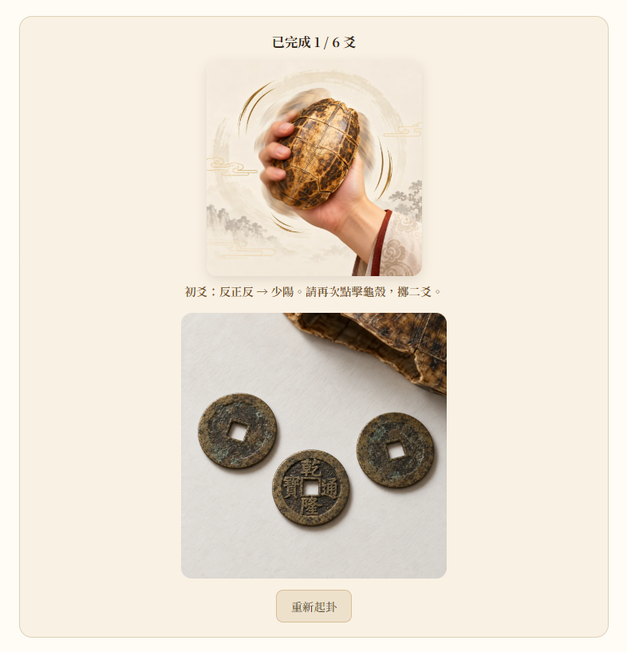
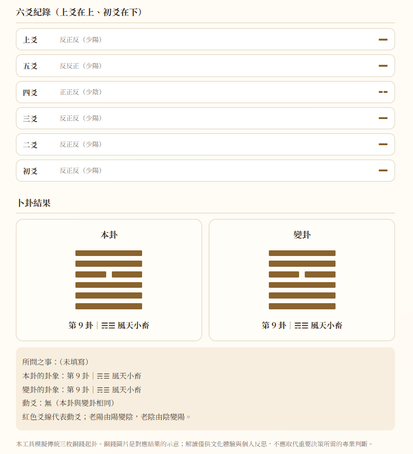

# 六爻卜卦系統｜Divination

**以傳統三枚銅錢起卦為主題的互動式前端作品，從原生 JavaScript 實作延伸至 Vue 3。**

輸入問題、點擊龜殼完成六次擲幣，即可查看六爻紀錄、本卦、變卦與動爻。以米白紙感、金棕配色及龜殼與銅錢圖像，將抽象的陰陽變化轉為可操作、可閱讀的視覺流程。


## 作品導覽

| 版本 | 技術 | 適合觀看的重點 | 入口 |
| --- | --- | --- | --- |
| 原生版 | HTML、CSS、JavaScript | DOM 操作、非同步互動、無框架實作 | [index.html](index.html) |
| Vue 版 | Vue 3、Composition API、Vite | 響應式狀態、衍生資料、邏輯與樣式分離 | [vue-version](vue-version/) |

本儲存庫包含可執行的程式與展示截圖。截圖為使用者提供的操作畫面，各張圖片可能來自不同次起卦，並非同一筆結果的連續紀錄。

## 功能與操作流程

1. **輸入問題**：第一次擲幣時保留問題快照，並鎖定輸入，避免中途更換問題。
2. **逐次起爻**：每次點擊龜殼播放約 850 毫秒動畫，模擬三枚銅錢並產生一爻；動畫期間防止重複點擊。
3. **累積六爻**：依初爻至上爻產生資料，畫面以上爻在上、初爻在下呈現。
4. **顯示卦象**：完成六爻後，比對 64 卦資料，同時顯示本卦、變卦、卦名、編號與動爻。
5. **重新起卦**：清除問題、紀錄與結果；動畫途中重設也不會讓舊的回呼寫入新一輪資料。

### 擲幣過程

每次操作呈現對應的三枚銅錢示意圖、爻的類型與目前進度，讓使用者理解每一步產生的結果。



### 六爻紀錄與結果

結果頁將六爻紀錄、本卦與變卦並列展示；紅色爻線標示發生變化的位置，摘要再次列出問題與卦象。




## 技術設計與面試討論重點

### 以資料表示卦象

三枚銅錢以「正 = 3、反 = 2」加總，將結果映射為四種爻。六個陰陽值組成六位二進位字串，作為 64 卦查表的鍵值。

| 加總 | 爻類型 | 本卦 | 變卦 | 動爻 |
| --- | --- | --- | --- | --- |
| 6 | 老陰 | 陰（0） | 陽（1） | 是 |
| 7 | 少陽 | 陽（1） | 陽（1） | 否 |
| 8 | 少陰 | 陰（0） | 陰（0） | 否 |
| 9 | 老陽 | 陽（1） | 陰（0） | 是 |

資料以初爻開始累積；查表前反轉為「上爻 → 初爻」，前三位表示上卦、後三位表示下卦。這也是實作時必須處理的資料順序與顯示順序差異。

### 從 DOM 操作轉為響應式介面

- **原生版**：透過事件監聽、DOM 節點建立與 class 切換更新畫面。
- **Vue 版**：以 `ref` 管理問題、六爻與動畫狀態；以 `computed` 推導完成狀態、歷史紀錄排序與卦象結果，降低手動同步畫面的負擔。
- **責任分離**：`divination.js` 集中卦象資料與運算，`App.vue` 負責互動與呈現，`style.css` 管理外觀。

### 非同步操作與重設

兩版皆使用工作階段編號判斷回呼是否仍有效。Vue 版另外在重設及元件卸載時清除計時器，避免舊動畫覆寫狀態。此處可用來討論競態條件、資源清理及防止重複操作。

### 介面細節

- 以 CSS Grid、彈性寬度與媒體查詢調整手機版面。
- 以原生 `button` 支援鍵盤操作，並提供焦點樣式與圖片替代文字。
- 使用 `aria-live` 告知擲幣狀態，並以 `prefers-reduced-motion` 配合減少動態效果偏好。
- 優先使用 Web Crypto 產生銅錢正反面；環境不支援時回退至 `Math.random()`。

## 本機執行

```bash
git clone https://github.com/DarkShadow9321/Divination.git
cd Divination
```

**原生版**：直接以瀏覽器開啟根目錄的 `index.html`，或透過編輯器的靜態伺服器預覽。請保留同層的 `image/` 資料夾。

**Vue 版**：先安裝 Node.js 與 npm，再執行以下指令。本次整理使用 Node.js 24 執行驗證。

```bash
cd vue-version
npm ci
npm run dev
```

開啟終端機顯示的本機網址。

```bash
npm run test:logic
npm run build
npm run preview
```

邏輯測試涵蓋 64 卦鍵值完整性、四類爻的結果轉換，以及 1,000 次隨機起爻資料檢查；不代表完整的瀏覽器互動或無障礙測試。

## 檔案結構

```text
Divination/
├── README.md
├── index.html                 # 原生 HTML / CSS / JavaScript 版本
├── image/                     # 原生版龜殼與八組銅錢示意圖
├── docs/screenshots/          # 四張作品展示截圖
└── vue-version/
    ├── src/
    │   ├── App.vue            # 互動、狀態與模板
    │   ├── divination.js      # 卦象資料與運算
    │   ├── main.js            # Vue 入口
    │   └── style.css          # 視覺與響應式樣式
    ├── public/image/          # Vue 版靜態素材
    ├── test/logic.test.mjs    # 卦象邏輯檢查
    ├── package-lock.json      # 固定依賴版本
    └── vite.config.js
```

## 部署與目前範圍

原生版可部署至靜態網站空間。若使用 GitHub Pages，可在儲存庫 Settings → Pages 選擇由 `main` 分支的根目錄發布；是否已啟用請以儲存庫設定為準。

Vue 版設定相對資源路徑；執行 `npm run build` 後，可將 `vue-version/dist/` 部署至靜態網站空間。

目前為純前端作品，沒有後端、帳號、歷史資料持久化或自動卦辭解讀；重新整理即清除本次紀錄。後續可延伸為可注入隨機來源的單元測試、完整操作流程測試、元件拆分與本機歷史紀錄。

圖片為起卦結果的視覺示意素材，並非經鑑定的古錢幣照片。此作品以文化體驗與個人反思為主。
